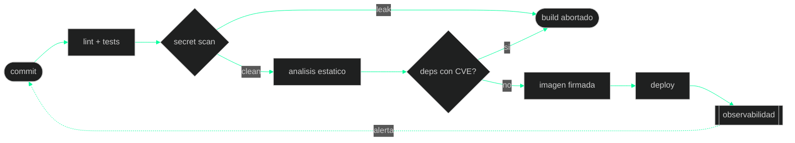

<div align="center">


<br/>


[](https://github.com/ezeibarra888)

</div>

---

## `$ whoami`

```yaml
operador:
  nombre:     Ezequiel Ibarra
  alias:      ezedev
  rol:        Fullstack Developer / DevSecOps
  base:       Argentina
  idiomas:    [ es, en ]

mision:
  - construir software de gestion que corre en produccion, no en slides
  - automatizar el deploy hasta que apretar un boton sea aburrido
  - tratar la seguridad como requisito, no como parche final

principios:
  - shift_left: "la vulnerabilidad mas barata es la que nunca se mergeo"
  - least_privilege: true
  - logs: "si no se observa, no existe"
  - secrets_en_el_repo: never
```

---

## `$ cat arsenal.txt`

<table>
<tr>
<td valign="top" width="50%">

**Backend & Datos**


</td>
<td valign="top" width="50%">

**Frontend**


</td>
</tr>
<tr>
<td valign="top" width="50%">

**Infra & Pipeline**


</td>
<td valign="top" width="50%">

**Observabilidad & Defensa**


</td>
</tr>
</table>

---

## `$ trace --pipeline`



> El pipeline no esta para pasar, esta para frenar lo que no deberia salir.

---

## `$ ls -la proyectos/`

| | proyecto | descripcion | stack |
|---|---|---|---|
| `>` | **[EZEDEV · portfolio](https://github.com/ezeibarra888/portfolio)** | Portfolio con tematica cybersec: boot sequence, terminal interactiva, glitch text y easter eggs | `Vue 3` `TypeScript` `GSAP` |
| `>` | **[ezeibarra888.github.io](https://github.com/ezeibarra888/ezeibarra888.github.io)** | Landing personal, deploy continuo sobre GitHub Pages | `HTML` `CSS` |
| `>` | **[Alquila](https://github.com/ezeibarra888/Alquila_app)** | Gestion de alquileres: contratos, vencimientos y cobros | `TypeScript` |
| `#` | *clasificado* | Plataforma de gestion interna en produccion: API .NET 9, cliente React, app de escritorio Electron, sync con sistema legacy y alertas por Telegram | `.NET 9` `React` `SQL Server` |

<sub>Lo que mas me divierte vive en repos privados. Si queres ver el detalle, preguntame.</sub>

---

## `$ systemctl status actividad`

<div align="center">


<br/>


</div>

---

## `$ ping ezeibarra888`

<div align="center">

[](https://ezeibarra888.github.io/portfolio/)
[](https://www.linkedin.com/in/ezequiel-ybarra-bba3a6375/)
[](mailto:ezeibarra888@gmail.com)
[](https://github.com/ezeibarra888)

</div>

---

<div align="center">

```
[ sesion finalizada ]  ·  no dejes puertos abiertos  ·  _
```


</div>
