<div align="center">

<a href="https://ezeibarra888.github.io/portfolio/">
  
</a>


<br>


<a href="https://github.com/ezeibarra888"></a>

</div>

---

## `$ whoami --verbose`

<p align="center">
  
</p>

---

<div align="center">

## `$ cat arsenal.yaml`

<table border="1" cellpadding="14" bgcolor="#0b1014">
  <thead>
    <tr><th colspan="2" align="left"><code>ezeibarra888@secnode:~$ cat arsenal.yaml</code></th></tr>
  </thead>
  <tbody>
    <tr>
      <td width="50%" valign="top"><code>├─ ◆ backend_y_datos:</code><br><br>
        <br>
        <sub><code>C# · .NET 9 · EF Core · SQL Server · Node.js</code></sub>
      </td>
      <td width="50%" valign="top"><code>├─ ▣ frontend:</code><br><br>
        <br>
        <sub><code>TypeScript · React · Vue 3 · Vite · Electron</code></sub>
      </td>
    </tr>
    <tr>
      <td valign="top"><code>├─ ⚙ infra_y_ci_cd:</code><br><br>
        
        <br>
        <sub><code>Docker · Dokploy · Jenkins · GitHub Actions · Traefik · Linux</code></sub>
      </td>
      <td valign="top"><code>├─ ◉ observabilidad:</code><br><br>
        <br>
        <sub><code>Grafana · Prometheus · Sentry · Seq · Zabbix · alertas a Telegram</code></sub>
      </td>
    </tr>
    <tr>
      <td colspan="2" valign="top"><code>╰─ ⌁ seguridad:</code><br><br>
        
        <br>
        <sub><code>escaneo de secretos · least privilege · RBAC · TLS / mTLS · hardening de contenedores · analisis de trafico</code></sub>
      </td>
    </tr>
  </tbody>
  <tfoot>
    <tr><td colspan="2"><code>status: ready&nbsp;&nbsp;·&nbsp;&nbsp;environment: production&nbsp;&nbsp;·&nbsp;&nbsp;secrets: 0 expuestos</code></td></tr>
  </tfoot>
</table>

</div>

---

## `$ trace --pipeline`

<p align="center">
  
</p>

> El pipeline no está para pasar, está para **frenar lo que no debería salir**.

---

## `$ scan --stack`

<p align="center">
  
  &nbsp;
  
</p>

<p align="center">
  
  
</p>

---

## `$ ls -la proyectos/`

| | proyecto | descripción | stack |
|---|---|---|---|
| `>` | **[EZEDEV · portfolio](https://github.com/ezeibarra888/portfolio)** | Portfolio con temática cybersec: boot sequence, terminal interactiva, glitch text y easter eggs | `Vue 3` `TypeScript` `GSAP` |
| `>` | **[ezeibarra888.github.io](https://github.com/ezeibarra888/ezeibarra888.github.io)** | Landing personal con deploy continuo sobre GitHub Pages | `HTML` `CSS` |
| `>` | **[Alquila](https://github.com/ezeibarra888/Alquila_app)** | Gestión de alquileres: contratos, vencimientos y cobros | `TypeScript` |
| `#` | **`[ clasificado ]`** | Plataforma de gestión en producción: API .NET 9, cliente React, app de escritorio Electron, sincronización con un sistema legacy y alertas por Telegram | `.NET 9` `React` `SQL Server` |

<sub>`#` lo que más me divierte vive en repos privados. Si te interesa el detalle, preguntame.</sub>

---

## `$ connect --socials`

<div align="center">

<a href="https://ezeibarra888.github.io/portfolio/"></a>
&nbsp;
<a href="https://www.linkedin.com/in/ezequiel-ybarra-bba3a6375/"></a>
&nbsp;
<a href="mailto:ezeibarra888@gmail.com"></a>
&nbsp;
<a href="https://github.com/ezeibarra888"></a>

</div>

<br>

<div align="center">

```
root@secnode:~# logout
[ sesión finalizada ]  ·  no dejes puertos abiertos  ·  exit 0
```

<sub>Hecho desde Argentina · <code>@ezeibarra888</code></sub>

</div>
